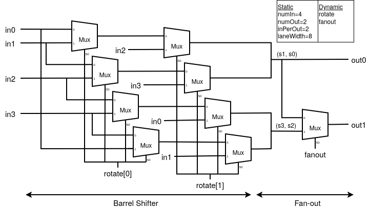

# Xccel

Xccel is a framework for exploring the SRAM design and compute unit in X-ray detector ASICs simulateniously.
This framework abstracts near-sensor AI accelerators to the input activation buffer, weight buffer, accumulator, compute unit, and instraction decoder, assuming deterministic dataflow such as Groq.
The user (whichever the human or AI agents) can specify the number of SRAMs and design of each buffer including depth, word length, the number of ports, port bandwidth, mask granularity, and read/write latency.
Moreover, the user can replace a compute unit with their IP such as systolic array, reduction tree, and vector engine.
It does not have any caches, reservation station, and arbiters inside the accelerator since it adopts deterministic dataflow architecture.

## Usage

```bash
./gwscript.py
```

## Lane Connectivity

These four **static** connectivities between lanes (i.e., how to wire lanes between each element) are possible.

- 1:1
  - one input lane, one output lane
- 1:N
  - one wide input lane feeds several output lanes
- N:1
  - several narrow input lanes feed one wide lane
- N:M
  - one input/output lanes have several wire

Besides, SRAM macros can take several patterns of ports including 1rw, 1r1w, and 2rw.

For **dynamic** cast modes (i.e., how to pass data on the lane at runtime), including unicast, multicast, and broadcast, are implemented.

- rotate: cyclic left rotation of the input lanes (window select), implemented by a barrel shifter between components (e.g., interface between SRAM and systolic array mesh)
- fanout: log2 of how many consecutive output lanes share one group of input lanes (e.g., broadcasting: each mesh takes the same data loaded from a single address)
  - 0: unicast, 1 <= N < log2Ceil(numOut): multicast, log2Ceil(numOut): broadcast




## Horizontal Microcode

To realize deterministic dataflow architecture, Xccel adopts the horizontal microcode.

| Component    | Signal          | Type (Length)                                  |
|--------------|-----------------|------------------------------------------------|
| wbRead       | en              | Bool                                           |
|              | addr            | UInt(wbAddrWidth.W)                            |
|              | addrStride      | UInt(wbAddrWidth.W)                            |
|              | rotate          | UInt(wbRotateWidth.W)                          |
|              | rotateStride    | UInt(wbRotateWidth.W)                          |
|              | fanout          | UInt(wbFanoutWidth.W)                          |
| wbWrite      | en              | Bool                                           |
|              | addr            | UInt(wbAddrWidth.W)                            |
|              | addrStride      | UInt(wbAddrWidth.W)                            |
|              | fromRequantizer | Bool                                           |
|              | transposed      | Bool                                           |
|              | column          | UInt(transposerIndexWidth.W)                   |
|              | columnStride    | UInt(transposerIndexWidth.W)                   |
| weightPort   | en              | Bool                                           |
|              | addr            | UInt(weightPortAddrWidth.W)                    |
|              | addrStride      | UInt(weightPortAddrWidth.W)                    |
|              | slot            | Bool                                           |
| abWrite      | en              | Bool                                           |
|              | addr            | UInt(abAddrWidth.W)                            |
|              | addrStride      | UInt(abAddrWidth.W)                            |
|              | fromRequantizer | Bool                                           |
| abRead       | en              | Bool                                           |
|              | addr            | UInt(abAddrWidth.W)                            |
|              | addrStride      | UInt(abAddrWidth.W)                            |
|              | rotate          | UInt(abRotateWidth.W)                          |
|              | rotateStride    | UInt(abRotateWidth.W)                          |
|              | fanout          | UInt(abFanoutWidth.W)                          |
| compute      | weightSelect    | Bool                                           |
| accWrite     | addr            | UInt(accAddrWidth.W)                           |
|              | addrStride      | UInt(accAddrWidth.W)                           |
|              | accumulate      | Bool                                           |
| accRead      | en              | Bool                                           |
|              | addr            | UInt(accAddrWidth.W)                           |
|              | addrStride      | UInt(accAddrWidth.W)                           |
|              | rotate          | UInt(accRotateWidth.W)                         |
|              | rotateStride    | UInt(accRotateWidth.W)                         |
|              | fanout          | UInt(accFanoutWidth.W)                         |
| requant      | paramSet        | UInt(requantSetWidth.W)                        |
| transposer   | capture         | Bool                                           |
|              | row             | UInt(transposerIndexWidth.W)                   |
|              | rowStride       | UInt(transposerIndexWidth.W)                   |
| softmax      | op              | UInt(3.W) (None / Max / Sum / Divide / Out)    |
|              | first           | Bool                                           |
|              | lanes           | UInt(softmaxLanesWidth.W)                      |
|              | stat            | UInt(softmaxStatWidth.W)                       |
| softmax.buf  | store           | Bool                                           |
| (rowBeats>0) | beat            | UInt(beatWidth.W)                              |
|              | sumOp           | UInt(2.W) (None / Sum / Divide)                |
|              | sumStat         | UInt(softmaxStatWidth.W)                       |
|              | sumBeat         | UInt(beatWidth.W)                              |
|              | sumFirst        | Bool                                           |
|              | sumLanes        | UInt(softmaxLanesWidth.W)                      |
|              | outEn           | Bool                                           |
|              | outStat         | UInt(softmaxStatWidth.W)                       |
|              | outBeat         | UInt(beatWidth.W)                              |
|              | outLanes        | UInt(softmaxLanesWidth.W)                      |
| residual     | en              | Bool                                           |
|              | paramSet        | UInt(residualSetWidth.W)                       |
| (word)       | cycles          | UInt(cyclesWidth.W)                            |
|              | halt            | Bool                                           |

| width                                | definition                                            |
|--------------------------------------|-------------------------------------------------------|
| wbAddrWidth                          | log2Ceil(WeightBuffer rows)                           |
| wbRotateWidth                        | log2Ceil(words per WeightBuffer row)                  |
| wbFanoutWidth                        | log2Ceil(maxFanout + 1) (0: field absent)             |
| abAddrWidth                          | log2Ceil(ActivationBuffer rows)                       |
| abRotateWidth / abFanoutWidth        | ActivationBuffer LaneSwitch (input lanes = rows R)    |
| accAddrWidth                         | log2Ceil(Accumulator rows)                            |
| accRotateWidth / accFanoutWidth      | Accumulator LaneSwitch (input lanes = cols C)         |
| weightPortAddrWidth                  | log2Ceil(compute unit weight beats)                   |
| transposerIndexWidth                 | log2Ceil(C)                                           |
| requantSetWidth                      | max(1, log2Ceil(Requantizer parameter sets))          |
| softmaxLanesWidth                    | log2Ceil(C + 1)                                       |
| softmaxStatWidth                     | max(1, log2Ceil(softmax stats))                       |
| beatWidth                            | max(1, log2Ceil(softmax row beats))                   |
| residualSetWidth                     | max(1, log2Ceil(residual parameter sets))             |
| cyclesWidth                          | log2Ceil(maxRunLength + 1)                            |


## Scheduler (tentative)


## Related Works

- A. Parashar et al., "Timeloop: A Systematic Approach to DNN Accelerator Evaluation," 2019 IEEE International Symposium on Performance Analysis of Systems and Software (ISPASS), Madison, WI, USA, 2019, pp. 304-315, doi: 10.1109/ISPASS.2019.00042. keywords

